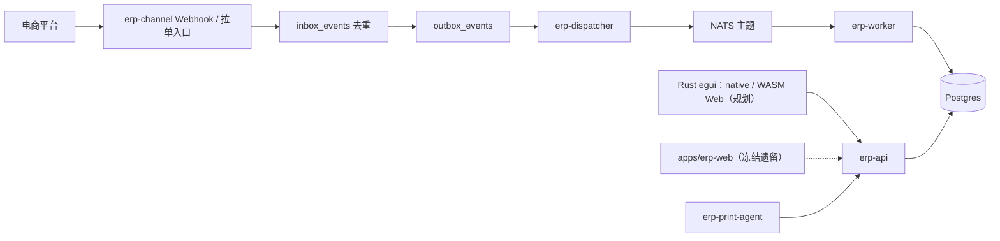

# 架构与接口约定

> 更新日期：2026-09-09  
> 本文合并原开发总览、架构概要、接口边界、数据模型、平台接入、状态机与流程文档中的长期有效内容。

2026-10-01 产品目标更新为官方托管的免费制造与贸易 ERP，见 [产品范围](PRODUCT_SCOPE.md) 与 [功能验收清单](FREE_ERP_CHECKLIST.md)。下文电商链路继续作为已有实现参考；旧自用和 SaaS 后置是历史阶段，Rust 双端、API、数据边界和业务分层规则继续有效。制造域和公网托管按路线图分批补齐，本文不据此宣称新架构已经落地。

## 总体架构

项目采用“Rust 原生桌面/WASM Web 工作台 + Rust 多服务 + 事件驱动 + OpenAPI 契约 + Postgres 事实存储”的结构。

核心思想：外部平台事件先进入 Inbox 做幂等去重，再写 Outbox，由 Dispatcher 发布到消息总线，Worker 消费后更新业务投影，API 和 Web 管理端围绕投影与业务动作工作。

## 服务职责

| 服务 / 目录 | 职责 |
| --- | --- |
| `crates/erp-channel` | 接收平台 Webhook、落库原始 payload、去重并产生 Outbox 事件 |
| `crates/erp-dispatcher` | 扫描 Outbox，按租户与事件类型发布到 NATS |
| `crates/erp-worker` | 消费业务事件，执行订单、商品、库存等投影更新 |
| `crates/erp-api` | 对外提供管理 API、鉴权、权限、审计、业务动作和 OpenAPI 契约 |
| `crates/erp-repo` | 数据访问、仓储实现和测试夹具 |
| `crates/erp-domain` / `erp-types` | 领域类型、枚举、状态与跨服务共享结构 |
| `crates/adapter-*` | 淘宝、京东、拼多多、抖音等平台适配器 |
| `crates/erp-print-agent` | 打印设备、打印任务和本地打印桥接 |
| `apps/erp-ui`（规划） | 共享 Rust/egui 页面及 native/web 宿主 |
| `apps/erp-web` | 冻结的 React 管理端，仅作业务参考 |
| `openapi/erp_api_v1.yaml` | API 契约权威来源，前端客户端与验收以此为准 |
| `migrations/` | 数据结构演进与上线前数据库依据 |

## UI 结构（2026-09-09 决策）

- 全部新 UI 使用 Rust：eframe/egui + wgpu 原生桌面，Web 使用共享代码编译 WASM。自绘界面不等于 OS 原生控件，Web 不重建 React 页面。
- erp-grid-core（纯状态机）、erp-ui-egui（共享渲染/组件）、apps/erp-ui（实验台及未来页面/API/宿主）已创建首批实现；完整 API 与业务尚未接入，详细契约见 [组件库规范](UI_COMPONENT_LIBRARY.md)。
- 后端保留现有 Rust 服务、OpenAPI 和数据库边界，两端均通过 API 查询及执行业务；不向客户端下发平台密钥、不允许桌面直连数据库。
- 文件、剪贴板、持久化、打印、网络认证与生命周期区分 native/web 实现。Web 同源会话及 CSRF 需后端适配；现有 JWT 接口不证明浏览器认证已经完成。
- AG Grid 全面禁用，所有业务表格经自研 DataGrid。旧 React 引用是冻结遗留，非继续使用授权。当前无用户，无须逐页复刻旧前端；明确选择的自用流程不能静默降级。
- Rust 固定 1.98.1、Edition 2024、resolver 3、rustfmt style edition 2024；配置已更新，现有代码兼容尚未编译验证。文档规范不代表组件、门禁和双端交付完成。
- 自用先行，3—5 商家阶段优先同版独立部署，SaaS 后置；进度只维护在 [路线图](ROADMAP.md)。

## 后端接口边界

- `erp-api` 是业务管理接口入口，所有需要权限、审计和业务动作的操作都应经过它。
- `erp-channel` 只负责平台入站、验签、去重和事件投递前置，不承载复杂业务编排。
- `erp-worker` 处理异步投影、补偿、同步任务和事件驱动的业务更新。
- `adapter-*` 只封装平台差异，不向上泄漏平台字段细节。
- 前端不得绕过 API 直接依赖数据库结构。

## 后端模块边界与分层约束

后续开发必须以业务域和 bounded context 组织代码，避免把新能力继续堆回入口文件或巨型 handler。

| 层级 | 职责 | 禁止事项 |
| --- | --- | --- |
| `router` | 只挂载路由、组合业务域 router、注入共享状态 | 不写业务编排、SQL、状态机或复杂参数转换 |
| `handler` | 鉴权、租户解析、参数校验、调用 service、响应映射、错误码转换 | 不直接承载跨域事务和复杂业务规则 |
| `service` | 业务事务、领域动作编排、幂等、补偿、跨 repo 协调 | 不处理 HTTP 展示细节 |
| `repo` | 数据查询、持久化、行模型转换、测试夹具复用 | 不处理权限、页面语义或平台协议 |
| `domain` | 状态机、枚举、业务守卫、纯规则和错误类型 | 不访问数据库、HTTP 请求或外部平台 |
| `adapter` | 平台协议、签名、字段转换、API 调用和平台错误归一化 | 不向业务层泄漏平台原始字段 |

模块规模约束：

- `crates/erp-api/src/lib.rs` 当前作为历史兼容入口，必须保持在 `10,000` 行以内，并逐步只保留共享类型、兼容 re-export 和轻量 glue。
- `crates/erp-api/src/router.rs` 必须继续拆为 `routes/` 下的业务域聚合模块，最终只保留顶层组合入口。
- 除入口兼容文件外，API 单模块不得超过 `5,000` 行；超过阈值必须拆成子目录聚合模块。
- 新增 P0 能力时，优先同时建立 route、handler、service、repo、domain 边界，不允许先堆到单文件再“以后拆”。
- 模块化约束由 `cargo test -p erp-api --test app_modularization -- --nocapture` 和 `cargo test -p erp-worker --test worker_modularization -- --nocapture` 守护。

## 数据域边界

| 数据域 | 核心对象 | 约定 |
| --- | --- | --- |
| 租户与权限 | tenants、users、roles、permissions、data scopes | 所有业务数据必须带租户边界，关键动作必须可审计 |
| 平台接入 | shops、platform auth、sync jobs、field mappings | 平台差异在适配器和映射层处理，内部保持统一模型 |
| 订单 | orders、order_items、order state logs、order actions | 状态机统一，动作必须声明前置条件和后置影响 |
| 商品 | products、skus、barcodes、kits、shop products | SKU 是履约和库存的基础，渠道商品必须可映射到内部 SKU |
| 库存与 WMS | warehouses、locations、inventory balances、ledgers、inbounds、shipments | 库存变化必须经过台账，不能只改余额 |
| 物流与打印 | carriers、couriers、waybills、print templates、print jobs | 面单和打印任务要可重试、可追踪、可审计 |
| 售后 | after-sale cases、refunds、returns、reverse inspections | 售后必须关联订单、物流、库存和财务影响 |
| 财务 | settlements、receivables、payables、cost ledgers、reconciliation | 先做经营对账，再扩展完整财务核算 |

## 状态与动作规则

- 状态变更必须记录触发动作、操作者、时间、原因和关联对象。
- 影响库存、财务、履约或售后的动作必须具备幂等键和失败补偿策略。
- 可回退动作必须写明回退原因、审批人和回退后的库存 / 财务影响。
- 订单、出入库、采购、售后和结算的状态字典要在领域类型、OpenAPI 和前端展示中保持一致。

## 平台接入规则

- 入站请求必须完成平台验签、租户 / 店铺识别、幂等去重和原始 payload 留存。
- 字段映射必须保留平台原始值、内部标准值和映射版本。
- 轮询补偿必须能按平台、店铺、对象类型、时间窗口和失败原因查询。
- 失败重试必须区分可重试、不可重试、需人工修复和需平台介入。

## OpenAPI 与权限

- `openapi/erp_api_v1.yaml` 是接口契约权威来源。
- 新增业务 API 必须包含请求体、响应体、错误码、权限标记和必要的分页 / 过滤参数。
- 权限命名要能体现业务域、资源和动作，例如 `OMS.ORDER.REVIEW`、`WMS.INVENTORY.WRITE`。
- 前端按钮、批量动作和后端 API 权限必须一致，不能只在前端隐藏。

## 本地数据种子

本地演示租户、店铺、角色和权限种子已迁移到 `scripts/seed.local.sql`。执行前先运行数据库迁移，并按文件注释替换返回的租户、角色和用户 UUID。
