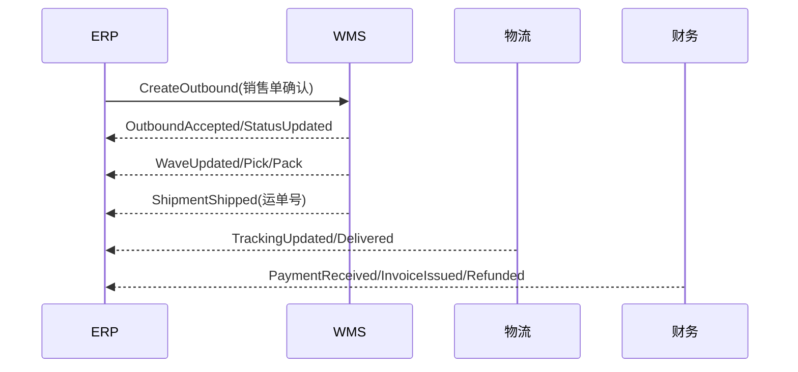

# ERP 集成事件与回传契约

> 目标：明确 ERP 与 WMS/物流/财务的协作边界、事件契约与补偿规则，支撑状态机稳定落地。

## 1. 协作边界
- **ERP**：负责销售单审核、状态机驱动、出库指令下发与回传聚合。
- **WMS**：负责出库单、波次、拣货/打包/发运执行与状态回传。
- **物流**：提供运单、轨迹回传与签收结果。
- **财务/开票**：提供收款、退款与开票结果回传。

## 2. 交互流程（示意）

## 3. ERP -> WMS 请求
### 3.1 创建出库单（CreateOutbound）
| 字段 | 必填 | 说明 |
| --- | --- | --- |
| tenant_id | 是 | 租户 |
| sales_order_id | 是 | 销售单ID |
| outbound_id | 是 | ERP 出库单ID |
| warehouse_id | 是 | 发货仓 |
| items | 是 | SKU 明细（sku_id/qty/price_cent/lot） |
| receiver | 是 | 收货人（姓名/电话/地址） |
| shipping_service | 否 | 物流服务/承运商 |
| expected_ship_at | 否 | 期望发货时间 |
| idempotency_key | 是 | 幂等键 |
| trace_id | 否 | 链路追踪 |

### 3.2 取消/释放出库单（CancelOutbound）
| 字段 | 必填 | 说明 |
| --- | --- | --- |
| outbound_id | 是 | 出库单ID |
| reason | 是 | 取消原因 |
| operator | 是 | 操作人 |
| idempotency_key | 是 | 幂等键 |

### 3.3 波次策略下发（可选）
| 字段 | 必填 | 说明 |
| --- | --- | --- |
| wave_rule_id | 否 | 波次策略ID |
| wave_strategy | 否 | 先波后分/先分后波 |
| max_orders | 否 | 波次订单上限 |
| max_wait_minutes | 否 | 最大等待时间 |

## 4. WMS -> ERP 回传事件
| event_code | 触发点 | 更新字段 | 说明 |
| --- | --- | --- | --- |
| wms_outbound_created | 出库单创建 | `wms_outbound_status` | 同步出库单状态 |
| wms_wave_created | 波次生成 | `wms_wave_status` | 波次进入已生成 |
| wms_wave_released | 波次下发 | `wms_wave_status` | 波次进入已下发 |
| wms_pick_started | 拣货开始 | `wms_pick_status` | 拣货执行中 |
| wms_pack_completed | 打包完成 | `wms_pack_status` | 打包完成 |
| wms_shipped | 发货完成 | `delivery_status`/`wms_ship_status` | 更新发货与运单号 |
| wms_ship_failed | 发货失败 | `wms_ship_status` | 发货失败待重试 |
| wms_outbound_closed | 出库单关闭 | `wms_outbound_status` | 出库单取消 |

## 5. 回传公共字段
| 字段 | 说明 |
| --- | --- |
| tenant_id | 租户 |
| sales_order_id | 销售单ID |
| outbound_id | 出库单ID |
| wave_id | 波次ID |
| package_id | 包裹ID |
| status | 当前状态 |
| status_reason | 状态原因 |
| occurred_at | 发生时间 |
| idempotency_key | 幂等键 |
| trace_id | 链路追踪 |
| payload | 原始扩展字段 |

## 6. 幂等与顺序
- `idempotency_key` 唯一，重复回传直接幂等返回。
- 状态不回退：低优先级/旧时间戳回传直接忽略。
- 回传入库后写入 `order_status_history` 与 `order_action_log`。

## 7. 异常与补偿
- 创建出库失败：销售单进入 `ON_HOLD`，记录异常原因，允许重试下发。
- 发货失败：标记 `HAS_EXCEPTION`，允许重新发货或撤销包裹。
- 取消失败：生成补偿任务并提醒人工处理。

## 8. 财务/开票/对账回传
- `PaymentReceived`：更新 `payment_status` 与已收金额。
- `InvoiceIssued`：更新 `invoice_status` 与开票金额。
- `RefundCompleted`：更新 `refund_status` 与退款金额。
- `ReconcileResult`：更新对账结果并记录差异原因。

## 9. 监控与审计
- 关键回传写入审计日志与指标（回传成功率/超时率/重试次数）。
- 与 `docs/spec/security_and_audit.md` 的审计规范保持一致。
