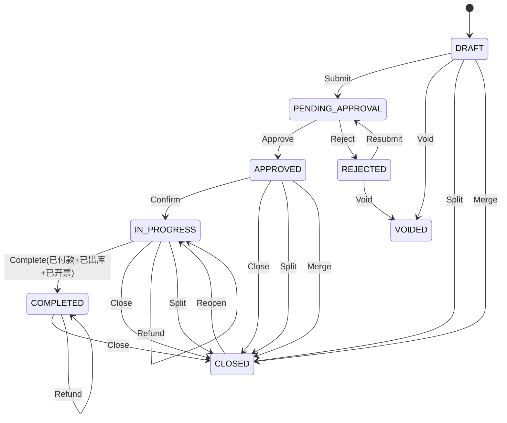
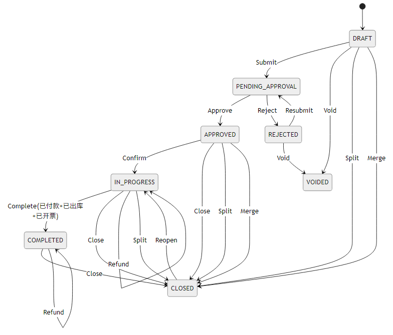

# 销售单状态机草案

> 口径说明（2026-04-10）：本文件为“销售单状态机草案”，用于设计讨论与补充说明。  
> 当前执行口径优先参考 `docs/spec/12_sales_order_status_actions.md`、`docs/spec/14_action_permission_matrix.md` 与 `docs/spec/order_workflow_api_updates_2026-04-07.md`。

> 目标：用**少量主状态 + 可配置流程任务 + 辅助状态**覆盖复杂企业流程，避免状态爆炸，同时保证审计与可追溯。

本文与 `docs/spec/04_order_status_machine.md`、`docs/spec/12_sales_order_status_actions.md` 对齐：前者描述平台订单状态映射，后者描述前端聚合状态与动作。本篇聚焦销售单（内部业务单）状态机，主状态建议命名为 `sales_order_status`（若已占用 `sales_status` 字段，可在接口层做映射）。

## 0. 适用范围与设计原则
- 适用范围：ERP 内部销售单（报价/审批/履约/开票/收款），可聚合多平台订单。
- 分层：主状态（生命周期）+ 辅助状态（并行维度）+ 流程任务（审批/异常）。
- 动作驱动：主状态只由 Action 改写，辅助状态变化只影响可用动作与完成判定。
- 履约边界：出库/发货由 WMS 处理，销售单只下发出库指令并消费回传更新 `delivery_status`。
- 配置化：状态/迁移/权限/条件可配置，支持多租户流程版本。
- 可追溯：所有动作落 `order_status_history` 与审计日志，支持回放/对账。

## 1. 主状态（SalesOrderStatus / sales_order_status）
主状态只描述**单据生命周期阶段**，不承载细节。

| 状态编码 | 名称 | 说明 | 是否终态 |
| --- | --- | --- | --- |
| DRAFT | 草稿 | 录入/暂存，未进入流程 | 否 |
| PENDING_APPROVAL | 待审批 | 进入审批流程 | 否 |
| REJECTED | 已驳回 | 审批退回，可修改再提 | 否 |
| APPROVED | 已审批 | 审批通过，等待执行 | 否 |
| IN_PROGRESS | 执行中 | 备货/出库/发货/开票/付款中 | 否 |
| COMPLETED | 已完成 | 交付/开票/付款满足完成条件 | 否 |
| CLOSED | 已关闭 | 业务中止/主动关闭 | 是 |
| VOIDED | 已作废 | 未生效直接作废 | 是 |

### 1.1 状态能力矩阵（动作/冻结/自动迁移）
| 状态 | 允许动作 | 字段冻结 | 自动迁移/触发 |
| --- | --- | --- | --- |
| DRAFT | Submit / Void / Split / Merge | 无 | - |
| PENDING_APPROVAL | Approve / Reject | 核心字段冻结 | 审批结果驱动 |
| REJECTED | Resubmit / Void | 核心字段可编辑 | - |
| APPROVED | Confirm / Close / Split / Merge | 核心字段冻结 | Confirm -> IN_PROGRESS |
| IN_PROGRESS | Ship / Invoice / ReceivePayment / Refund / Close / Split | 履约相关字段冻结 | 满足完成条件 -> Complete |
| COMPLETED | Close / Refund | 只读 | - |
| CLOSED | Reopen | 只读 | - |
| VOIDED | - | 只读 | - |

### 1.2 与前端聚合状态映射（建议）
| sales_order_status | 前端 `sales_status` | 说明 |
| --- | --- | --- |
| DRAFT | NEW | 草稿/未进入审核 |
| PENDING_APPROVAL | REVIEW_PENDING | 待审核 |
| REJECTED | REVIEW_REJECTED | 审核驳回 |
| APPROVED | READY_TO_SHIP | 已审待发 |
| IN_PROGRESS | FULFILLING | 履约中 |
| COMPLETED | DONE | 已完成 |
| CLOSED | CANCELLED | 关单归档 |
| VOIDED | CANCELLED | 作废/取消 |

> 若 `status_flags` 命中异常/冻结，前端可覆写展示为 `ON_HOLD`。

## 2. 辅助状态（拆解复杂度）
辅助状态用于表达履约细节，不影响主状态数量。

### 2.1 辅助状态字段与枚举
| 字段 | 枚举 | 说明 | 影响主状态 |
| --- | --- | --- | --- |
| `delivery_status` | NOT_SHIPPED / PARTIALLY_SHIPPED / SHIPPED | 出库/发货进度（来自 WMS 出库单/包裹回传） | 参与完成条件 |
| `invoice_status` | NOT_INVOICED / PARTIALLY_INVOICED / INVOICED | 开票进度 | 参与完成条件 |
| `payment_status` | UNPAID / PARTIALLY_PAID / PAID | 收款进度 | 参与完成条件 |
| `refund_status` | NONE / PARTIAL_REFUND / REFUNDED | 退款进度 | 不直接改变主状态 |
| `return_status`（可选） | NONE / PARTIAL_RETURN / RETURNED | 退货进度 | 影响退款/重开规则 |
| `stock_status`（可选） | NOT_RESERVED / RESERVED / RELEASED | 库存占用 | 影响 Close/Confirm |

### 2.1.1 WMS 扩展字段（可选）
| 字段 | 枚举/来源 | 说明 |
| --- | --- | --- |
| `wms_outbound_status` | `OutboundStatus` | WMS 出库单状态，用于展示与追溯 |
| `wms_wave_status` | `WaveStatus` | WMS 波次状态，见 `docs/spec/erp-process-flows/02-出入库流程.md` |
| `wms_pick_status` | `PickStatus` | 拣货状态（可选，细粒度） |
| `wms_pack_status` | `PackStatus` | 打包状态（可选，细粒度） |
| `wms_ship_status` | `ShipStatus` | 发货单/包裹状态 |

### 2.2 状态标记（status_flags）
| 标记 | 说明 | 典型来源 | 影响 |
| --- | --- | --- | --- |
| `HAS_EXCEPTION` | 异常命中 | `exception_flags` 非空 | 可覆写为 ON_HOLD |
| `IS_FROZEN` | 单据冻结 | `freeze_reason` 非空 | 限制动作 |
| `HAS_SPLIT` | 存在拆单 | 拆单关系表 | 展示/追溯 |
| `PARTIAL_SHIPPED` | 部分发货 | 包裹汇总 | 影响可用动作 |
| `HAS_AFTER_SALE` | 售后处理中 | 售后单状态 | 影响退款/关单 |

### 2.3 辅助状态联动规则
- 辅助状态变化只触发完成判定与动作可用性刷新，不直接改主状态。
- `delivery_status = PARTIALLY_SHIPPED` 仅标记 `PARTIAL_SHIPPED`，主状态仍保持 `IN_PROGRESS`。
- 退款/退货更新 `refund_status`、`return_status`，主状态保持不变。

### 2.4 WMS 履约状态映射（细化）
以 WMS 回传的履约/出库状态为准，ERP 只做聚合与展示。

#### 2.4.1 出库单状态（OutboundStatus） -> `delivery_status`
| WMS 出库单状态 | `delivery_status` | 说明 |
| --- | --- | --- |
| DRAFT / PENDING_REVIEW | NOT_SHIPPED | 出库单已生成，待审核 |
| PENDING_ALLOCATE | NOT_SHIPPED | 待分配波次/拣货 |
| PENDING_PICK / PICKING | NOT_SHIPPED | 拣货中 |
| PENDING_VERIFY / PENDING_PACK | NOT_SHIPPED | 复核/打包中 |
| PENDING_SHIP | NOT_SHIPPED | 待交运 |
| SHIPPED | SHIPPED | 出库完成 |
| CLOSED | NOT_SHIPPED | 出库单取消/关闭 |

#### 2.4.2 波次状态（WaveStatus） -> `status_flags`
| 波次状态 | 说明 | 建议标记 |
| --- | --- | --- |
| WAVE_CREATED | 波次已生成，未下发 | - |
| RELEASED | 波次已下发，等待拣货 | - |
| PICKING | 波次拣货中 | - |
| PACKING | 波次打包中 | - |
| READY_TO_SHIP | 波次待发运 | - |
| SHIPPED / SIGNED | 波次完成 | - |
| CANCELLED | 波次取消 | `HAS_EXCEPTION` |

#### 2.4.3 发货单/包裹状态（ShipStatus） -> `delivery_status`
| 发货单状态 | `delivery_status` | 说明 |
| --- | --- | --- |
| NOT_SHIPPED / SHIPPING | NOT_SHIPPED | 包裹未完成发货 |
| SHIPPED | SHIPPED | 包裹已发货 |
| SHIP_FAILED | NOT_SHIPPED | 发货失败，需要重试 |
| 多包裹部分发货 | PARTIALLY_SHIPPED | 订单级汇总 |

### 2.5 ERP + WMS 协作流程（摘要）
- 销售单 `APPROVED/Confirm` 后下发 WMS 出库单（出库单状态见 `docs/spec/erp-process-flows/02-出入库流程.md`）。
- WMS 根据出库单生成波次并拆分拣货/复核/打包/发运任务，最终产出发货单/包裹单。
- WMS 回传波次、包裹、发货结果与物流单号，ERP 消费回传更新 `delivery_status` 与扩展字段。
- ERP 消费 WMS 回传更新 `delivery_status` 与 `status_flags`，再驱动开票/收款/完成判定。
- 关单/取消需调用 WMS 释放库存或取消出库任务，保持库存一致。

## 3. 关键动作（Action）
动作是状态迁移的唯一入口，禁止直接改状态字段。
若销售单需要统一动作输出，动作码与权限请对齐 `docs/spec/12_sales_order_status_actions.md`，前端仅渲染 `available_actions`。

- Create：创建草稿
- Submit：提交审批
- Approve：审批通过
- Reject：订单驳回/审批驳回
- Resubmit：修改后再提交
- Confirm：下达执行（锁单/占用库存）
- Ship：出库/发货
- Invoice：开票
- ReceivePayment：收款/付款确认
- Refund：退款/部分退款
- Complete：完成（系统判断）
- Close：业务关闭
- Void：作废
- Reopen（可选）：强制重开
- Split：订单拆分
- Merge：订单合并

### 3.1 动作定义与校验
| 动作 | 入口状态 | 关键校验 | 状态变化 | 副作用 |
| --- | --- | --- | --- | --- |
| Create | - | 创建草稿 | -> DRAFT | 初始化字段/版本 |
| Submit | DRAFT | 必填字段/金额校验 | -> PENDING_APPROVAL | 生成流程实例/冻结字段 |
| Approve | PENDING_APPROVAL | 全部节点通过 | -> APPROVED | 生成履约计划 |
| Reject | PENDING_APPROVAL | 驳回原因 | -> REJECTED | 解冻字段 |
| Resubmit | REJECTED | 修改记录 | -> PENDING_APPROVAL | 新流程版本 |
| Confirm | APPROVED | 库存占用成功 | -> IN_PROGRESS | 生成 WMS 出库单/波次 |
| Ship | IN_PROGRESS | WMS 出库/包裹回传 | 状态不变 | 更新 `delivery_status` |
| Invoice | IN_PROGRESS | 开票校验 | 状态不变 | 更新 `invoice_status` |
| ReceivePayment | IN_PROGRESS | 收款金额校验 | 状态不变 | 更新 `payment_status` |
| Complete | IN_PROGRESS | 完成条件满足 | -> COMPLETED | 关闭履约任务 |
| Refund | IN_PROGRESS/COMPLETED | 已付款/额度校验 | 状态不变 | 更新 `refund_status` |
| Close | APPROVED/IN_PROGRESS/COMPLETED | 关单条件 | -> CLOSED | 释放库存/取消 WMS 任务 |
| Void | DRAFT/REJECTED | 无履约财务影响 | -> VOIDED | 记录作废原因 |
| Reopen | CLOSED | 高权限+原因 | -> IN_PROGRESS | 恢复任务 |
| Split | DRAFT/APPROVED/IN_PROGRESS | 拆分规则 | -> CLOSED | 生成子单 |
| Merge | DRAFT/APPROVED | 合并规则 | -> CLOSED | 生成合并单 |

### 3.2 动作码映射与幂等
- 建议维护 `action_code -> Action` 映射表，统一权限与审计口径。
- 动作请求携带 `version` 做乐观锁，版本不一致直接拒绝。
- 对外接口需支持 `idempotency_key`，重复请求返回历史结果。
## 4. 状态转移矩阵（核心约束）

| From | Action | To | 条件 | 备注 |
| --- | --- | --- | --- | --- |
| DRAFT | Submit | PENDING_APPROVAL | 字段校验通过 | 进入流程实例 |
| DRAFT | Void | VOIDED | 未触发库存/财务 | 记录作废原因 |
| PENDING_APPROVAL | Approve | APPROVED | 全部审批节点通过 | 生成执行任务 |
| PENDING_APPROVAL | Reject | REJECTED | 任一驳回 | 记录驳回原因 |
| REJECTED | Resubmit | PENDING_APPROVAL | 修改后再次提交 | 生成新流程任务 |
| REJECTED | Void | VOIDED | 未触发库存/财务 | 记录作废原因 |
| APPROVED | Confirm | IN_PROGRESS | 库存占用成功 | 进入履约 |
| IN_PROGRESS | Complete | COMPLETED | 发货/开票/付款满足条件 | 系统自动 |
| IN_PROGRESS / COMPLETED | Refund | 原状态 | 已付款且退款金额合规 | 更新退款状态 |
| APPROVED / IN_PROGRESS | Close | CLOSED | 允许关闭条件满足 | 撤销占用/释放资源 |
| COMPLETED | Close | CLOSED | 归档 | 可选 |
| CLOSED | Reopen | IN_PROGRESS | 高权限+原因 | 可选 |
| DRAFT / APPROVED / IN_PROGRESS | Split | CLOSED | 拆分规则满足 | 原单关闭，生成子单 |
| DRAFT / APPROVED | Merge | CLOSED | 合并规则满足 | 原单关闭，生成合并单 |

> 完成条件必须包含：`PaymentStatus=已付款`，建议默认条件为  
> `DeliveryStatus=已出库 && InvoiceStatus=已开票 && PaymentStatus=已付款`  
> 允许部分退款时，不阻塞完成，但需记录 `RefundStatus` 与退款金额。

### 4.1 完成条件计算（建议逻辑）
- 必选条件：`payment_status == PAID`。
- 默认条件：`delivery_status == SHIPPED && invoice_status == INVOICED && payment_status == PAID`。
- 可配置项：允许无票/先票后货/货到付款等策略。
- 全额退款时可自动触发 `Close`（配置项）。

### 4.2 辅助状态触发与主状态关系
- 辅助状态变更触发“完成判定”，但不直接变更主状态。
- `delivery_status` 由 WMS 回传驱动，ERP 不允许直接写入。
- `delivery_status` 进入 `PARTIALLY_SHIPPED` 时，主状态保持 `IN_PROGRESS` 并挂 `PARTIAL_SHIPPED` 标记。
- 退款/退货仅更新辅助状态与标记，主状态保持不变。

### 4.3 并发与幂等
- 动作请求携带 `version` 做乐观锁校验，冲突返回错误并提示刷新。
- 对外接口支持 `idempotency_key`，重复请求直接返回上次处理结果。
- 关键迁移（Confirm/Close/Refund）需事务化处理并写入 outbox。

### 流程图（Mermaid）

> 拆分/合并会生成新单据，原单据进入 `CLOSED` 并记录原因。

## 5. 业务约束（必须落地为规则）

- **编辑限制**：只有 `DRAFT/REJECTED` 可编辑核心字段（客户/价格/币种/税率），其他状态需走变更单或重新审批。
- **审批冻结**：`PENDING_APPROVAL` 冻结关键字段，避免审批口径变化。
- **履约限制**：出库/发货由 WMS 执行，ERP 仅在 `APPROVED/IN_PROGRESS` 下发出库并接收回传。
- **付款强制**：`Complete` 前 `PaymentStatus` 必须为 `已付款`。
- **开票约束**：开票金额不得超过应收/已收，税率与币种需与订单一致。
- **收款对账**：累计收款不得超过应收，退款金额不得超过已收。
- **退款规则**：允许部分退款，仅在已付款后执行，更新 `RefundStatus` 与退款金额。
- **冻结拦截**：存在异常/冻结标记时，禁止发货/收款/关单，需先解除。
- **关闭约束**：`Close` 必须写入原因并回滚占用库存、未执行任务。
- **作废约束**：`Void` 仅限未发生业务影响的单据（未出库/未开票/未付款）。
- **拆分/合并**：满足规则后生成新单；原单进入 `CLOSED` 且记录原因（拆分/合并）。
- **状态一致性**：辅助状态变化可触发主状态校验，但主状态只能由 Action 驱动。
- **变更重审**：金额/数量/价格变化需重新审批（生成新审批任务）。

## 6. 审批流程（流程任务）
审批属于“流程任务层”，与主状态解耦。

- 支持串行/并行/会签/加签/转交/超时
- 节点状态：待办 / 通过 / 驳回 / 转交 / 超时
- 结果聚合：**全部通过** -> `APPROVED`，**任一驳回** -> `REJECTED`
- 流程版本化：单据绑定 `flow_version`，避免在途单据被新流程影响
- 节点实例需记录处理人、处理时间、驳回原因与时效

## 7. 配置化数据结构建议

| 表/配置 | 用途 |
| --- | --- |
| flow_definition | 流程元信息（编码、版本、启用） |
| flow_state | 状态清单（编码、名称、终态） |
| flow_transition | 状态迁移（from、action、to、条件表达式、权限） |
| flow_task_node | 审批节点定义（类型、分配规则、会签策略） |
| flow_instance | 单据与流程实例关联（当前节点、版本、状态） |
| flow_task_instance | 审批节点实例（处理人/时效/结果） |
| order_action_log | 动作日志（action/idempotency_key/request/response） |
| order_aux_status | 辅助状态快照（delivery/invoice/payment/refund） |
| order_relation | 拆分/合并关系（parent/child） |
| order_freeze | 冻结原因与来源（风控/人工） |
| order_status_history | 状态历史（from/to/action/operator/reason/time） |

## 8. 审计与异常

- 每次迁移写入 `order_status_history`，保留操作人、原因、时间
- 超时提醒：长期停留 `PENDING_APPROVAL/IN_PROGRESS` 自动预警
- 强制关闭/重开：高权限、双确认、原因必填
- 关键动作写入审计日志（action、参数、结果）
- 指标建议：审批超时、履约超时、退款超时、关单数量趋势

## 9. 实现清单（项目优化落地）
- 状态字段：`sales_order_status` + `delivery_status/invoice_status/payment_status/refund_status` + `status_flags`。
- 状态机服务：动作校验、迁移、历史记录、幂等与并发控制。
- 动作接口：Submit/Approve/Reject/Confirm/Ship/Invoice/ReceivePayment/Refund/Close/Void/Split/Merge/Reopen。
- WMS 对接：出库单下发、波次生成、包裹/发货回传、取消与释放库存回滚。
- 自动任务：完成判定、超时预警、异常冻结、关单自动化。
- 前端输出：`sales_status` + `available_actions`，通过映射表统一展示。

## 10. 待确认项（落地前需业务确认）

- 允许部分交付完成吗？是否允许部分关闭？
- 拆分/合并后是否保留审批结果，还是需要重审？
- 退款是否允许全额退款后自动关闭？
- 是否需要“销售单变更单”机制
- 审批角色与额度规则（金额阈值/客户等级/信用）

---
如需我进一步细化，请告诉我：销售单字段、审批角色、完成条件、动作接口与异常策略。
