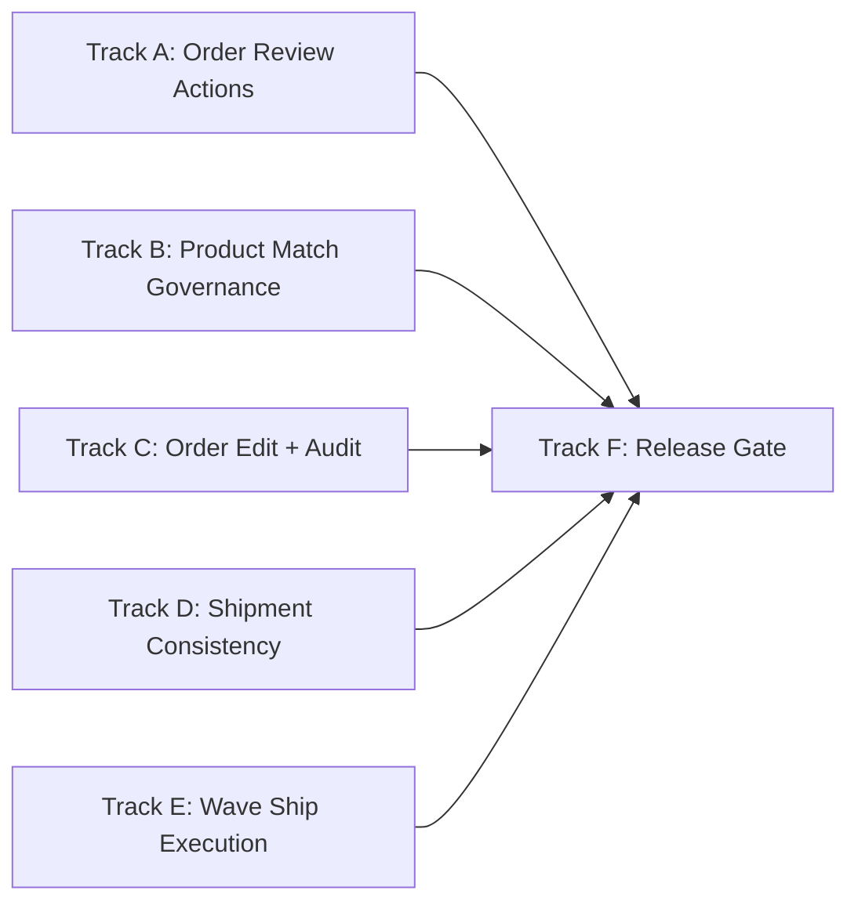

# Industrial ERP Order/Match/Ship/Wave Implementation Plan

> **For agentic workers:** REQUIRED SUB-SKILL: Use superpowers:subagent-driven-development (recommended) or superpowers:executing-plans to implement this plan task-by-task. Steps use checkbox (`- [ ]`) syntax for tracking.

**Goal:** 面向企业级电商 ERP，上线“订单处理、商品匹配、订单修改、发货单发货、波次发货”五条主链的可执行闭环，并补齐可审计、可回放、可观测能力。

**Architecture:** 采用“OMS 审核工作台 + 商品匹配任务中心 + WMS 出库与波次 + Shipment 事件回写”的分层架构。前端以 `OrderReviewPage`/`ShopProductDownloadPage`/`Wms*` 页面为操作入口，后端以 `/orders`、`/shop-products`、`/wms`、`/shipments` API 为事务边界，统一落审计日志和状态历史。

**Tech Stack:** React + TypeScript + Ant Design + React Query + Playwright + Rust + Axum + SQLx + Postgres + OpenAPI + NATS

---

## 1. 企业级标签评估（针对五条主链）

评估口径：
- 5 分：工业级可规模上线（流程、权限、审计、回滚、监控完整）
- 4 分：业务可上线（有闭环，细节仍需加固）
- 3 分：主流程可用（存在明显功能缺口或回归风险）
- 2 分：以页面/API 为主，闭环不足
- 1 分：仅原型或占位

### 1.1 当前结论（2026-04-13）

| 能力域 | 评分 | 结论 |
| --- | --- | --- |
| 订单处理（审核/异常/状态机） | 3.2 / 5 | 后端 API 与权限较完整，但新 `OrderReviewPage` 的审核/拆单/合单按钮未绑定动作，导致前端主入口闭环断裂。 |
| 商品匹配（下载/自动匹配/手工匹配） | 3.8 / 5 | `shop-products` 任务化链路已成型，具备下载、自动匹配、手工匹配、删匹配；需补冲突治理与 E2E 深度。 |
| 订单修改（明细货品/仓库/物流） | 3.5 / 5 | `updateOrder` + 审核页底部货品编辑已可用，需补并发版本冲突提示与审计追踪一致性。 |
| 发货单发货（OMS/WMS） | 3.9 / 5 | OMS 发货、WMS 出库发运、Shipment confirm/outbox 具备，需补跨链路一致性回归与失败补偿编排。 |
| 波次发货（规则/运行/打印/发运） | 3.6 / 5 | 波次规则、运行、打印与 API 已具备；前端缺“波次发货执行”主操作页内闭环与更严格测试。 |
| 企业级治理（审计/门禁/可观测） | 3.7 / 5 | OpenAPI、权限测试、release gate 基础较强；需把五条主链纳入统一发布门禁矩阵。 |

### 1.2 证据锚点（代码事实）

- 订单审核新页面按钮无动作绑定：`apps/erp-web/src/pages/orders/OrderReviewPage.tsx:1710-1722`
- 旧审核拆合单能力仍存在但未在路由入口暴露：`apps/erp-web/src/pages/orders/OrderSplitMergeLegacyPage.tsx:1347-1491`
- 订单审核路由指向新页面：`apps/erp-web/src/app/router.tsx:470-474`
- 商品匹配页复用网店商品下载页：`apps/erp-web/src/pages/sales/SalesProductMatchPage.tsx:1-3`
- 商品匹配后端路由齐全：`crates/erp-api/src/lib.rs:10611-10647`
- WMS 波次路由齐全（run/ship/print）：`crates/erp-api/src/lib.rs:9400-9424`
- E2E 中拆单弹窗断言可跳过，存在“假绿”风险：`apps/erp-web/e2e/order-processing-flow.spec.ts:50-57`

### 1.3 直接结论

- 你当前项目不是“从 0 到 1”阶段，而是“主干能力已具备，但前端主入口出现回归断点”的阶段。
- 若以企业级承诺上线，必须优先修复订单审核工作台动作闭环，并把商品匹配与波次发货纳入同一发布门禁。

---

## 2. 上线范围与优先级

### 2.1 P0（必须完成）

- 订单审核主工作台恢复：审核、拆单、合单动作闭环可执行
- 商品匹配冲突治理：自动匹配失败、冲突原因、人工介入闭环
- 订单修改可审计：货品/仓库/物流修改均落操作日志与版本控制
- 发货单发货一致性：OMS/WMS/Shipment 状态一致，失败可补偿
- 波次发货执行闭环：波次运行后可批量发运并回写状态
- 门禁升级：五条主链必须有 API + E2E + 回归门禁

### 2.2 P1（紧随其后）

- 异常成本与 SLA 看板
- 回放中心（失败任务按链路重放）
- 波次策略版本化与灰度

---

### 2.3 Non-Negotiable DB Rules (Must Follow)

- Every business mutation must persist to database tables, not only update UI state.
- No task is considered complete unless schema migration, repository write path, and API contract are all aligned.
- For this program, action persistence is mandatory in all key chains:
  - Order mutation: `order_action_log` + `order_status_history`
  - Cross-module operation trace: `operation_logs`
  - Governance/audit trace: `audit_logs`
- Any new status, action code, or mutation field must have:
  - SQL migration in `migrations/` (forward compatible, idempotent)
  - Write/read path in `crates/erp-repo`
  - API field in `openapi/erp_api_v1.yaml`
  - Integration test assertion on persisted rows
- Release gate hard check:
  - Reject if only frontend behavior changed without persistent write verification.
  - Reject if mutation success path has no persisted action log record.

---

## 3. Codex 并行执行编排

并行原则：
- 每个子任务拥有独立写入边界，避免冲突
- 共享协议文件（OpenAPI、状态枚举）统一由“协议负责人”提交
- 每条子链必须提供：失败用例 -> 最小实现 -> 通过验证



---

### Task 0: DB Schema Baseline + Action Persistence Guard (P0)

**Files:**
- Modify: `F:/erp/openapi/erp_api_v1.yaml`
- Modify: `F:/erp/crates/erp-repo/src/order_action_logs.rs`
- Modify: `F:/erp/crates/erp-repo/src/order_status_history.rs`
- Modify: `F:/erp/crates/erp-repo/src/operation_logs.rs`
- Modify: `F:/erp/crates/erp-repo/src/audit_logs.rs`
- Create: `F:/erp/migrations/0093_order_match_ship_wave_action_guard.sql`
- Create: `F:/erp/docs/ops/DB_GUARD_ORDER_MATCH_SHIP_WAVE.md`
- Create: `F:/erp/crates/erp-api/tests/order_match_ship_wave_persistence_guard.rs`

- [ ] **Step 1: Write failing persistence-guard test to assert each chain writes action logs + status history**
- [ ] **Step 2: Run `cargo test -p erp-api --test order_match_ship_wave_persistence_guard -- --nocapture`, confirm FAIL**
- [ ] **Step 3: Add migration guard for required columns/indexes/constraints on action log and status history tables**
- [ ] **Step 4: Align repo write paths and OpenAPI fields with persistence schema**
- [ ] **Step 5: Re-run persistence-guard test and confirm PASS**
- [ ] **Step 6: Commit**

```bash
git add openapi/erp_api_v1.yaml crates/erp-repo/src/order_action_logs.rs crates/erp-repo/src/order_status_history.rs crates/erp-repo/src/operation_logs.rs crates/erp-repo/src/audit_logs.rs migrations/0093_order_match_ship_wave_action_guard.sql docs/ops/DB_GUARD_ORDER_MATCH_SHIP_WAVE.md crates/erp-api/tests/order_match_ship_wave_persistence_guard.rs
git commit -m "chore(db): add schema and persistence guard for order-match-ship-wave chains"
```

---

### Task 1: 恢复订单审核工作台主动作（P0）

**Files:**
- Modify: `F:/erp/apps/erp-web/src/pages/orders/OrderReviewPage.tsx`
- Modify: `F:/erp/apps/erp-web/src/pages/orders/review-native/OrderReviewMainGrid.tsx`
- Create: `F:/erp/apps/erp-web/src/pages/orders/review-native/orderReviewToolbarActions.ts`
- Create: `F:/erp/apps/erp-web/src/pages/orders/review-native/orderReviewToolbarActions.test.ts`
- Modify: `F:/erp/apps/erp-web/e2e/order-processing-flow.spec.ts`

- [ ] **Step 1: 写失败测试，覆盖审核/拆单/合单按钮触发与 API 调用**
- [ ] **Step 2: 运行 `pnpm --dir F:/erp/apps/erp-web test orderReviewToolbarActions --runInBand`，确认失败**
- [ ] **Step 3: 在新审核页绑定 `reviewOrder`/`splitOrder`/`mergeOrders` 动作，补成功与失败提示**
- [ ] **Step 3.1: Add integration assertions that review/split/merge writes `order_action_log` and `order_status_history`**
- [ ] **Step 4: 运行 `pnpm --dir F:/erp/apps/erp-web test orderReviewToolbarActions --runInBand`，确认通过**
- [ ] **Step 5: 运行 `pnpm --dir F:/erp/apps/erp-web exec playwright test e2e/order-processing-flow.spec.ts`，移除关键场景 skip**
- [ ] **Step 6: Commit**

```bash
git add apps/erp-web/src/pages/orders/OrderReviewPage.tsx apps/erp-web/src/pages/orders/review-native/OrderReviewMainGrid.tsx apps/erp-web/src/pages/orders/review-native/orderReviewToolbarActions.ts apps/erp-web/src/pages/orders/review-native/orderReviewToolbarActions.test.ts apps/erp-web/e2e/order-processing-flow.spec.ts
git commit -m "feat(orders): restore review split merge actions in review workbench"
```

---

### Task 2: 商品匹配冲突治理与可操作化（P0）

**Files:**
- Modify: `F:/erp/apps/erp-web/src/pages/shopProducts/ShopProductDownloadPage.tsx`
- Modify: `F:/erp/apps/erp-web/src/api/shopProducts.ts`
- Modify: `F:/erp/crates/erp-api/src/lib.rs`
- Modify: `F:/erp/crates/erp-repo/src/channel_sku_mappings.rs`
- Create: `F:/erp/apps/erp-web/e2e/shop-product-match-governance.spec.ts`
- Create: `F:/erp/crates/erp-api/tests/platform_sync_and_mapping_flow_integration.rs` (补充断言)

- [ ] **Step 1: 写失败测试，覆盖自动匹配失败清单、冲突原因展示、人工修复回写**
- [ ] **Step 2: 运行 `cargo test -p erp-api --test platform_sync_and_mapping_flow_integration -- --nocapture`，确认失败**
- [ ] **Step 3: 扩展冲突字段与筛选条件（`status/conflict_reason/match_source`）**
- [ ] **Step 3.1: Ensure manual/auto match operations persist action records into `operation_logs` with operator + payload metadata**
- [ ] **Step 4: 运行后端测试并通过**
- [ ] **Step 5: 运行 `pnpm --dir F:/erp/apps/erp-web exec playwright test e2e/shop-product-match-governance.spec.ts`**
- [ ] **Step 6: Commit**

```bash
git add apps/erp-web/src/pages/shopProducts/ShopProductDownloadPage.tsx apps/erp-web/src/api/shopProducts.ts crates/erp-api/src/lib.rs crates/erp-repo/src/channel_sku_mappings.rs apps/erp-web/e2e/shop-product-match-governance.spec.ts crates/erp-api/tests/platform_sync_and_mapping_flow_integration.rs
git commit -m "feat(match): add conflict governance and manual recovery workflow"
```

---

### Task 3: 订单修改一致性与审计闭环（P0）

**Files:**
- Modify: `F:/erp/apps/erp-web/src/pages/orders/review-native/OrderReviewBottomPanel.tsx`
- Modify: `F:/erp/apps/erp-web/src/pages/orders/OrderReviewPage.tsx`
- Modify: `F:/erp/crates/erp-api/src/orders.rs`
- Modify: `F:/erp/crates/erp-repo/src/orders.rs`
- Modify: `F:/erp/crates/erp-repo/src/order_action_logs.rs`
- Create: `F:/erp/crates/erp-api/tests/oms_orders.rs` (补版本冲突与审计断言)

- [ ] **Step 1: 写失败测试，覆盖货品修改并发冲突（version）与审计日志完整性**
- [ ] **Step 2: 运行 `cargo test -p erp-api --test oms_orders -- --nocapture`，确认失败**
- [ ] **Step 3: 对 `updateOrder` 补版本冲突反馈与前端重试提示**
- [ ] **Step 3.1: Enforce DB writes for edit actions (`order_action_log`) and reject success response when persistence fails**
- [ ] **Step 4: 运行后端测试并通过**
- [ ] **Step 5: 运行 `pnpm --dir F:/erp/apps/erp-web test OrderReviewMainGrid --runInBand`**
- [ ] **Step 6: Commit**

```bash
git add apps/erp-web/src/pages/orders/review-native/OrderReviewBottomPanel.tsx apps/erp-web/src/pages/orders/OrderReviewPage.tsx crates/erp-api/src/orders.rs crates/erp-repo/src/orders.rs crates/erp-repo/src/order_action_logs.rs crates/erp-api/tests/oms_orders.rs
git commit -m "feat(orders): enforce optimistic lock and audit completeness for order edits"
```

---

### Task 4: 发货单发货跨链路一致性（P0）

**Files:**
- Modify: `F:/erp/apps/erp-web/src/pages/orders/ShipOrderDrawer.tsx`
- Modify: `F:/erp/apps/erp-web/src/pages/wms/WmsShipPage.tsx`
- Modify: `F:/erp/crates/erp-api/src/orders.rs`
- Modify: `F:/erp/crates/erp-api/src/lib.rs`
- Modify: `F:/erp/crates/erp-repo/src/shipments.rs`
- Modify: `F:/erp/crates/erp-repo/src/wms.rs`
- Create: `F:/erp/crates/erp-api/tests/shipment_confirm.rs` (补回写断言)
- Create: `F:/erp/apps/erp-web/e2e/shipments-main-chain.spec.ts`

- [ ] **Step 1: 写失败测试，覆盖 OMS 发货 -> WMS 出库 -> shipment confirm/outbox 事件**
- [ ] **Step 2: 运行 `cargo test -p erp-api --test shipment_confirm -- --nocapture`，确认失败**
- [ ] **Step 3: 统一状态映射与失败补偿（含重试与幂等）**
- [ ] **Step 3.1: Ensure ship/confirm/cancel actions persist to `operation_logs` and outbound status snapshots are queryable**
- [ ] **Step 4: 运行后端测试并通过**
- [ ] **Step 5: 运行 `pnpm --dir F:/erp/apps/erp-web exec playwright test e2e/shipments-main-chain.spec.ts`**
- [ ] **Step 6: Commit**

```bash
git add apps/erp-web/src/pages/orders/ShipOrderDrawer.tsx apps/erp-web/src/pages/wms/WmsShipPage.tsx crates/erp-api/src/orders.rs crates/erp-api/src/lib.rs crates/erp-repo/src/shipments.rs crates/erp-repo/src/wms.rs crates/erp-api/tests/shipment_confirm.rs apps/erp-web/e2e/shipments-main-chain.spec.ts
git commit -m "feat(shipment): harden oms-wms-shipment consistency and compensation"
```

---

### Task 5: 波次发货执行闭环（P0）

**Files:**
- Modify: `F:/erp/apps/erp-web/src/pages/wms/WmsWavesPage.tsx`
- Modify: `F:/erp/apps/erp-web/src/api/wms.ts`
- Modify: `F:/erp/crates/erp-api/src/lib.rs`
- Modify: `F:/erp/crates/erp-repo/src/wms.rs`
- Modify: `F:/erp/crates/erp-repo/tests/wms_wave_rules.rs`
- Create: `F:/erp/apps/erp-web/e2e/wms-wave-ship-main-chain.spec.ts`

- [ ] **Step 1: 写失败测试，覆盖 `run wave -> inspect/pack -> wave ship` 全链路**
- [ ] **Step 2: 运行 `cargo test -p erp-repo --test wms_wave_rules -- --nocapture`，确认失败**
- [ ] **Step 3: 前端新增“波次发货执行”动作并展示部分失败结果**
- [ ] **Step 3.1: Ensure wave ship action persists doc-level execution rows and action logs for each outbound doc**
- [ ] **Step 4: 运行后端测试并通过**
- [ ] **Step 5: 运行 `pnpm --dir F:/erp/apps/erp-web exec playwright test e2e/wms-wave-ship-main-chain.spec.ts`**
- [ ] **Step 6: Commit**

```bash
git add apps/erp-web/src/pages/wms/WmsWavesPage.tsx apps/erp-web/src/api/wms.ts crates/erp-api/src/lib.rs crates/erp-repo/src/wms.rs crates/erp-repo/tests/wms_wave_rules.rs apps/erp-web/e2e/wms-wave-ship-main-chain.spec.ts
git commit -m "feat(wms): complete wave ship execution loop with partial failure handling"
```

---

### Task 6: 发布门禁与可观测收口（P0）

**Files:**
- Modify: `F:/erp/apps/erp-web/e2e/release-gate-main-chain.spec.ts`
- Modify: `F:/erp/apps/erp-web/e2e/release-gate-cross-chain.spec.ts`
- Modify: `F:/erp/docs/ops/RELEASE_GATE_CHECKLIST.md`
- Modify: `F:/erp/docs/ops/GO_NO_GO_CHECKLIST.md`
- Modify: `F:/erp/docs/ops/TASK_COMPLETION_MATRIX.md`

- [ ] **Step 1: 写失败测试，明确五条主链均需通过后方可放行**
- [ ] **Step 2: 运行 `pnpm --dir F:/erp/apps/erp-web exec playwright test e2e/release-gate-main-chain.spec.ts e2e/release-gate-cross-chain.spec.ts`，确认失败**
- [ ] **Step 3: 更新门禁脚本与文档，建立统一 Go/No-Go 检查项**
- [ ] **Step 3.1: Add DB gate checks: fail release if no persisted action rows for critical mutation tests**
- [ ] **Step 4: 运行门禁测试并通过**
- [ ] **Step 5: Commit**

```bash
git add apps/erp-web/e2e/release-gate-main-chain.spec.ts apps/erp-web/e2e/release-gate-cross-chain.spec.ts docs/ops/RELEASE_GATE_CHECKLIST.md docs/ops/GO_NO_GO_CHECKLIST.md docs/ops/TASK_COMPLETION_MATRIX.md
git commit -m "chore(release): enforce p0 chain gate for order-match-ship-wave"
```

---

## 4. 多子任务并行分配建议（可直接用于 Codex Worker）

| Worker | 负责域 | 写入边界 | 依赖 |
| --- | --- | --- | --- |
| Worker-A | 订单审核动作恢复 | `apps/erp-web/src/pages/orders/OrderReview*` + 对应前端测试 | 无 |
| Worker-B | 商品匹配治理 | `shopProducts` + `channel_sku_mappings` + mapping tests | 无 |
| Worker-C | 订单修改与审计 | `orders` API/Repo + `order_action_logs` | A（仅 UI 交互对齐） |
| Worker-D | 发货单一致性 | `ShipOrderDrawer` + `orders.rs` + `shipments/wms repo` | C（状态字段契约） |
| Worker-E | 波次发货闭环 | `WmsWavesPage` + `wms.ts` + `wms route/repo` | D（发货状态契约） |
| Worker-F | 发布门禁 | e2e release gate + ops docs | A/B/C/D/E 全部 |
| Worker-G | DB Guard Owner | `migrations/*` + persistence tests + schema docs | A/B/C/D/E/F 全部 |

并行节奏：
- 阶段 1 并行：A + B + C
- 阶段 2 并行：D + E + G
- 阶段 3 串行：F

---

## 5. 验收标准（工业级）

- 功能验收：五条主链均可在主入口页面完成端到端操作，不依赖隐藏页面
- 数据验收：关键状态在 OMS/WMS/Shipment 三域一致，审计日志可追溯
- 稳定性验收：关键操作幂等、重试、补偿策略可用
- 质量验收：API 集成测试 + E2E 门禁 + OpenAPI 契约一致性全部通过
- 数据持久化验收：关键动作在 `order_action_log / order_status_history / operation_logs / audit_logs` 至少命中一条且字段完整
- 发布验收：`RELEASE_GATE_CHECKLIST` 与 `GO_NO_GO_CHECKLIST` 全绿

---

## 6. 主要风险与回滚预案

- 风险 1：新审核页与 legacy 行为不一致导致线上回归
- 预案：保留 feature flag `orders.review.native_actions`，支持 1 分钟回切

- 风险 2：波次批量发货部分失败导致状态不一致
- 预案：`/wms/waves/:wave_id/ship` 返回逐单结果并支持重试队列

- 风险 3：商品匹配批量处理误匹配
- 预案：强制记录 `match_source/conflict_reason/operator_id` 并支持批量撤销

---

## 7. 执行入口

- 推荐执行模式：`superpowers:subagent-driven-development`
- 关键命令（建议）：
  - `pnpm --dir F:/erp/apps/erp-web test`
  - `pnpm --dir F:/erp/apps/erp-web exec playwright test`
  - `cargo test -p erp-api`
  - `cargo test -p erp-repo`
  - `pnpm run repo:verify`
